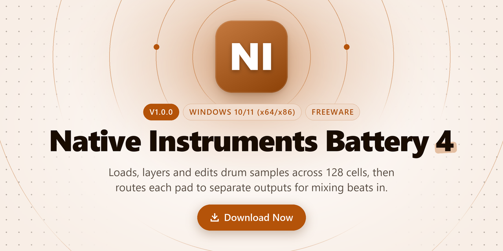

<h1 align="center">Native Instruments Battery 4 - Drum Sample Layer and Pad Routing Engine for Windows 10/11</h1>

<p align="center"><i>Battery 4 is a 128-cell drum sampler used by beatmakers, producers and sound designers to load, layer and edit samples, then route each pad to independent DAW outputs. This page documents requirements, configuration paths, engine modes, shortcuts, CLI flags and Windows-specific fixes.</i></p>

<p align="center">&nbsp;&nbsp;&nbsp;&nbsp;&nbsp;&nbsp;&nbsp;&nbsp;</p>

<p align="center"></p>

<p align="center">
  <a href="https://pavelphillips.github.io/native-instruments-battery-4/">
    <picture>
      <source media="(prefers-color-scheme: dark)" srcset="./assets/Click-dark.svg">
      
    </picture>
  </a>
</p>

<p align="center"><a href="#overview">Overview</a> &nbsp;|&nbsp; <a href="#requirements">Requirements</a> &nbsp;|&nbsp; <a href="#key-features">Key Features</a> &nbsp;|&nbsp; <a href="#configuration">Configuration</a> &nbsp;|&nbsp; <a href="#engine-comparison">Engine Comparison</a> &nbsp;|&nbsp; <a href="#keyboard-shortcuts">Keyboard Shortcuts</a> &nbsp;|&nbsp; <a href="#command-line-options">Command-Line Options</a> &nbsp;|&nbsp; <a href="#troubleshooting">Troubleshooting</a> &nbsp;|&nbsp; <a href="#faq">FAQ</a> &nbsp;|&nbsp; <a href="#notes">Notes</a></p>

## Overview

Battery 4 runs as a VST2, VST3, AAX and standalone instrument on Windows. It maps up to 128 sample cells across a 4x4 pad matrix per page, with per-cell effects, per-pad aux sends and multi-output routing into the host mixer.

### What It Does

Loads WAV, AIFF and NI sample content into 128 cells, layers up to four samples per cell, and applies pitch, envelope, filter and effect processing before routing each pad to a discrete stereo or mono output.

### Who It Is For

Beat producers working inside a DAW, sound designers building custom kits, and live performers who trigger pads via MIDI. Anyone who needs per-pad DAW mixing rather than a single stereo instrument bus.

### What Ships in the Build

The installer places the VST2 and VST3 plugins, the AAX plugin, the standalone application, the factory library content and the Native Access registration hooks. Content is authorized through Native Access, not embedded in the installer.

## Requirements

| Spec | Minimum | Recommended |
|------|---------|-------------|
| OS | Windows 10 (64-bit, 21H2) | Windows 11 (64-bit, 23H2 or later) |
| CPU | Intel Core i5 / AMD Ryzen 5, SSE2 | Intel Core i7 / AMD Ryzen 7, 3.0 GHz+ |
| RAM | 8 GB | 16 GB or more |
| Display | 1280x800, 100% scaling | 1920x1080, 125% scaling or higher |
| Storage | 2 GB free for plugin and app | 10 GB free on a sample library drive |
| Host / Plugin | VST2, VST3 or AAX host, or standalone | 64-bit DAW with multi-output bus support |

## Key Features

* **128-Cell Grid** , maps samples across four 4x4 pad pages with independent per-cell parameters.
* **Four-Layer Cells** , stacks up to four samples per cell with individual tuning and velocity curves.
* **Per-Pad Output Routing** , sends each cell to a discrete host output for external mixing.
* **Cell Effects** , applies saturation, compression, EQ and filter per sample slot.
* **Master and Aux Buses** , routes sends to two dedicated aux returns with time-based effects.
* **MIDI Learn and Mapping** , binds pads, macros and knobs to any incoming MIDI CC.
* **Library Browser** , filters factory and user kits by type, character and author.
* **Host Sync and Transport** , follows DAW tempo for looped cells and synced envelopes.

## Configuration

| Path | Purpose |
|------|---------|
| `%LOCALAPPDATA%\Native Instruments\Battery 4` | Per-user plugin state, browser database and scan cache |
| `%APPDATA%\Native Instruments\Battery 4` | User presets, kit edits and macro assignments |
| `%PROGRAMDATA%\Native Instruments\Battery 4` | Shared factory content index and library service data |
| `%PROGRAMDATA%\Native Instruments\Service Center` | Authorization and license token cache |
| `%USERPROFILE%\Documents\Native Instruments\Battery 4` | Exported kits, MIDI maps and per-project user samples |
| `%LOCALAPPDATA%\Native Instruments\Native Access` | Content install manifest and library paths |

| Setting | Default | Notes |
|---------|---------|-------|
| Multi-output mode | Stereo master only | Enable in plugin wrapper to expose discrete pad outs |
| Cell velocity sensitivity | Linear | Switch to exponential for expressive pad controllers |
| Pad output assignment | Master bus | Reassign per cell to aux or direct output |
| MIDI input channel | Omni | Lock to a single channel when running multiple instances |
| Browser content paths | Factory only | Add custom folders for user sample libraries |
| UI scaling | 100% | Override for HiDPI displays above 150% |
| Auto-save kit edits | Off | Enable to persist unsaved edits between sessions |

## Engine Comparison

| Engine Mode | Max Cells | CPU per Active Pad | Latency (buffer) | Best For |
|-------------|-----------|--------------------|------------------|----------|
| Standalone Stereo | 128 | ~0.3% | 256 samples | Sketching kits without a DAW |
| VST3 Multi-Out | 128 | ~0.4% | 128 samples | Per-pad mixing in a modern DAW |
| VST2 Multi-Out | 128 | ~0.4% | 128 samples | Legacy hosts without VST3 support |
| AAX Native | 128 | ~0.5% | 64 samples | Pro Tools production sessions |

## Keyboard Shortcuts

| Action | Shortcut |
|--------|----------|
| Save kit | Ctrl + S |
| Save kit as new | Ctrl + Shift + S |
| Load kit browser | Ctrl + O |
| Undo last edit | Ctrl + Z |
| Redo last edit | Ctrl + Y |
| Clear selected cell | Delete |
| Duplicate selected cell | Ctrl + D |
| Toggle cell edit panel | Ctrl + E |
| Next pad page | Ctrl + Right Arrow |
| Previous pad page | Ctrl + Left Arrow |

## Command-Line Options

| Flag | Argument | Purpose |
|------|----------|---------|
| `--standalone` | none | Launches the standalone app without the plugin wrapper |
| `--kit` | `<path.kit>` | Loads a specific kit file on startup |
| `--scan` | `<folder>` | Adds a sample folder to the browser index |
| `--safe-mode` | none | Disables third-party plugin scanning and UI overrides |
| `--no-gpu` | none | Forces software rendering for problematic GPU drivers |
| `--log` | `<level>` | Sets log verbosity (error, warn, info, debug) |
| `--reset-prefs` | none | Restores default preferences on next launch |
| `--content-path` | `<folder>` | Overrides the factory library root for portable installs |

```bash
Battery4.exe --standalone --kit "C:\Kits\Live Set.kit" --log info
```

| Exit Code | Meaning |
|-----------|---------|
| 0 | Clean exit |
| 1 | Kit file not found or unreadable |
| 2 | Authorization token invalid or expired |
| 3 | Content path missing or inaccessible |
| 4 | Audio driver initialization failure |

## Troubleshooting

### Pads route to a single stereo output in the DAW

The host only exposes one instrument bus by default. Battery 4's multi-output requires enabling additional buses in the plugin wrapper.

1. Open the plugin wrapper or channel routing menu in your DAW.
2. Enable outputs 2 through N as additional stereo or mono buses.
3. Reopen Battery 4 and assign cells to outputs in the pad routing panel.
4. Confirm audio reaches the new host channels by soloing a pad.
5. Save the DAW project so bus assignments persist.

### Cells play silently after loading a kit

Kits referencing samples on an unplugged or moved drive show no waveform. The browser index holds stale paths.

1. Open the browser and check for missing-content markers.
2. Point the library to the relocated sample folder via Configuration paths.
3. Re-scan the folder with the `--scan` flag or the browser rescan action.
4. Re-save the kit so the corrected paths persist.

### UI renders black or oversized on a HiDPI display

Windows per-monitor scaling can break the plugin's fixed-size window. The wrapper inherits OS scaling incorrectly.

1. Right-click the plugin executable and open Properties > Compatibility.
2. Set "Override high DPI scaling behavior" to Application.
3. Restart the DAW so the new scaling applies.
4. If the window is still clipped, launch with `--no-gpu`.

### Native Access shows Battery 4 as unregistered

The license token cache can desync after Windows updates or drive changes. Content remains installed but authorization fails.

1. Close all NI applications and the DAW.
2. Delete the Service Center token cache under `%PROGRAMDATA%`.
3. Reopen Native Access and sign in again.
4. Click Repair on Battery 4 to reissue the license token.

## FAQ

### Does each Battery 4 pad show up as a separate channel in my DAW mixer?

Yes, once multi-output is enabled on the plugin instance. Each cell can be assigned to its own host output, so a 16-pad kit can occupy 16 DAW mixer channels for individual processing.

### Can I load my own WAV files instead of the factory library?

Yes. Drop WAV or AIFF files directly onto cells, or add folders to the browser. Custom samples are referenced by path, so keep library drives mounted before opening kits that use them.

### How do I move a kit between two Windows machines?

Copy the `.kit` file and every sample folder it references, then re-point the browser paths on the target machine. Kits do not embed sample audio, so missing paths play silently.

## Notes

Native Instruments, Battery and Native Access are trademarks of Native Instruments GmbH. This page documents Battery 4 behavior on Windows 10/11; feature availability and installer layout may differ between releases.